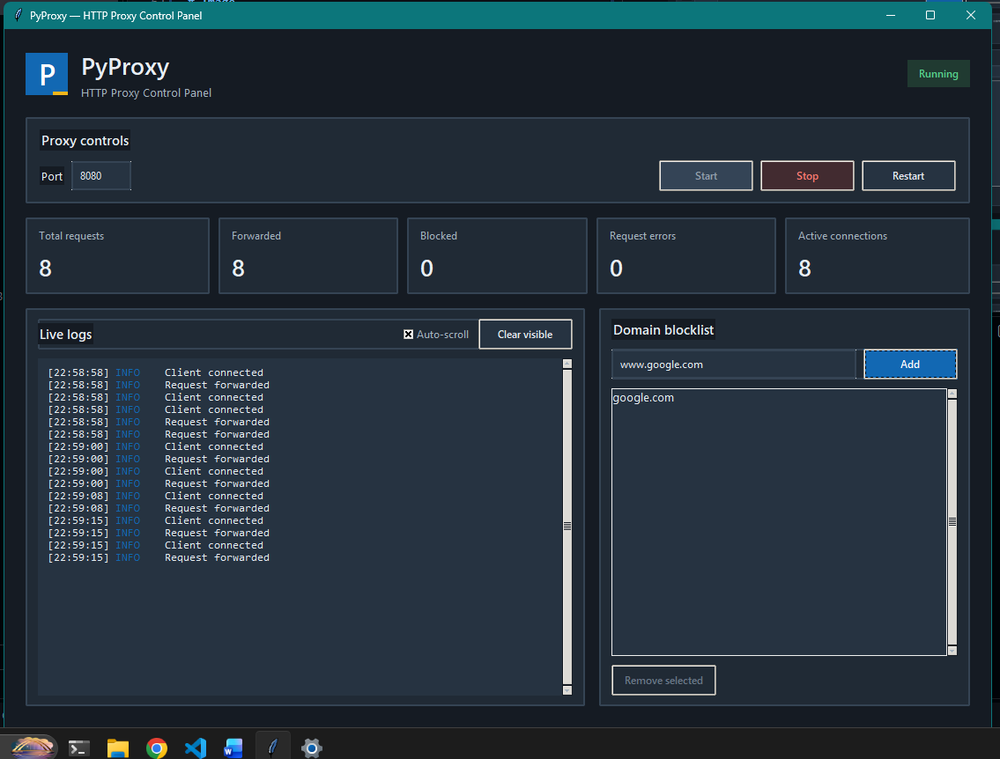

# PyProxy

PyProxy is a Tkinter control panel for the native HTTP proxy engine in Cpp language
`ProxyCore`.

## Credits

- Original C++ proxy implementation by [Jeel Kalathiya](https://github.com/Jeelk01).
- Binding of cpp and python by [Shubham Patel(me)](https://github.com/SHuBhAM71205)
- UI by Github Copilot

## Run the application

Use Python 3.13 or newer with Tkinter available:

```powershell
    #install deps
    python -m venv .venv

    source ./.venv/Scripts/Activate

    pip install .
```

Build the native extension from the repository root when it needs to be
recompiled:
```powershell
python setup.py build_ext --inplace
```
running:
```powershell
python main.py
```


Compiling whole file to .exe
```powershell
pyinstaller --clean --noconfirm --onefile --windowed --name PyProxy main.py
```

## Native wrapper API

`pyproxy_native.Proxy` directly wraps the native proxy:

| Method | Return value |
| --- | --- |
| `Proxy(port=8080)` | Creates a wrapper with the chosen listening port. |
| `start()` | Starts the proxy. |
| `stop()` | Stops it; a later `start()` creates a fresh native server. |
| `restart()` | Recreates and starts the native server. |
| `add_restricted_sites(site)` | Returns whether the site was added. |
| `remove_restricted_sites(site)` | Returns whether the site was removed. |
| `get_restricted_sites()` | Returns the current restricted sites as `list[str]`. |
| `set_event_callback(callback)` | Registers a callback receiving `(event_name, value)` events, or `None` to clear it. |

The native engine reports connection and request-count events through the
callback. The Tkinter UI queues those events and processes them on the UI thread
using a virtual event.

## Frontend structure

- `main.py` starts the application and calls the native wrapper directly.
- `wrapper.cpp` exposes the `ProxyCore` methods to Python.
- `pyproxy_native.pyi` describes the extension's Python API.
- `ui/` contains the independent Tkinter panels and shared styling.

# Image



